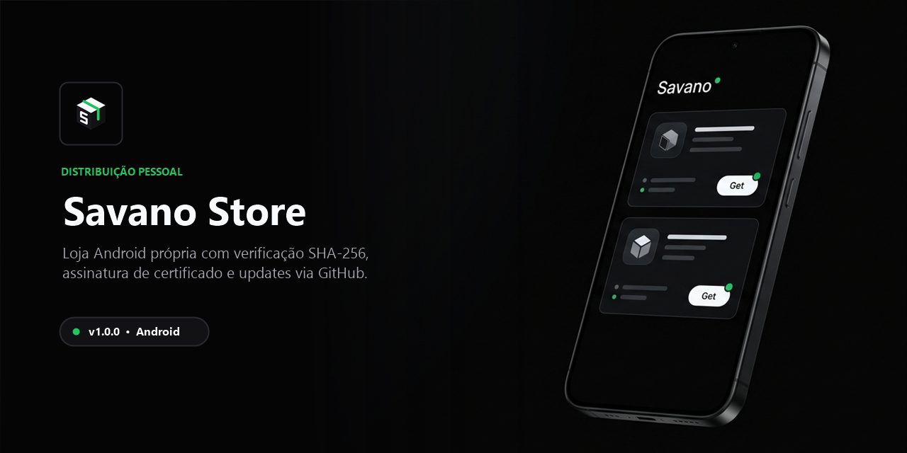

<p align="center">
  
</p>

# Savano Store

Loja pessoal de aplicativos Android (React Native / Expo SDK 58 + módulo nativo em Kotlin) para distribuir, instalar e atualizar APKs assinados com verificação criptográfica de ponta a ponta.

## Arquitetura & Segurança

- **Catálogo Remoto com Cache Offline (`catalog/catalog.json`):** hospedado via GitHub Pages (`https://savanoo.github.io/savano-store/catalog/catalog.json`) com fallback local em `AsyncStorage` e atualização rápida direto pelo cabeçalho da loja.
- **Módulo Nativo Kotlin (`modules/savano-installer`):**
  - Inspeção de apps instalados via `PackageManager` (`getInstalledApps`), exibindo **Instalar**, **Atualizar (`vX → vY`)** ou **Abrir**.
  - Download em streaming com progresso em tempo real e limite estrito de tamanho (`sizeBytes`).
  - Verificação obrigatória de **SHA-256**, manifesto do APK (`getPackageArchiveInfo`: `packageId` e `versionCode`) e **pinning de certificado de assinatura (`signerSha256`)** antes de abrir o instalador nativo via `FileProvider`.
  - Bloqueio de `http://` em release, validação de redirects em allowlist do GitHub e proteção anti-IP privado/loopback.
  - Tratamento explícito da permissão `REQUEST_INSTALL_PACKAGES` com atalho direto para as configurações do Android.
- **Identidade Visual Studio (`Pure Ink & Ivory`):** `#050506` / `#121215` / `#F8FAFC` / `#22C55E`, logo **Cubo Selado (`2A + S`)**, busca/filtros, auto-atualização da própria loja e **Modo Admin** oculto (5 toques na versão em *Ajustes*) para edição de URL.

## Comandos Principais

```powershell
# Validar testes unitários, tipagem e lint
npm test
npx tsc --noEmit
npx expo lint

# Publicar ou atualizar um app no catalog/catalog.json
node scripts/publish-release.mjs `
  --manifest ../Vocabulando/apps/mobile/release-manifest.json `
  --release-base-url https://github.com/SAVANOo/vocabulando/releases/download/v1.0.0 `
  --apk caminho/do/app.apk

# Gerar build de release da própria Savano Store
powershell -ExecutionPolicy Bypass -File scripts/build-store-release.ps1

# Criar atalho na Área de Trabalho (Windows)
powershell -ExecutionPolicy Bypass -File scripts/install-desktop-shortcut.ps1
```

## Documentação

- [docs/PUBLISHING.md](docs/PUBLISHING.md) — Contrato do `catalog.json` e fluxo de publicação.
- [docs/kanban.md](docs/kanban.md) — Roteiro operacional por ciclos.
- [docs/backlog-exploratorio.md](docs/backlog-exploratorio.md) — Estudo exploratório de segurança, UX e Engineering Playbook.
- [docs/security-and-quality.md](docs/security-and-quality.md) — Requisitos de segurança e *Definition of Done*.
